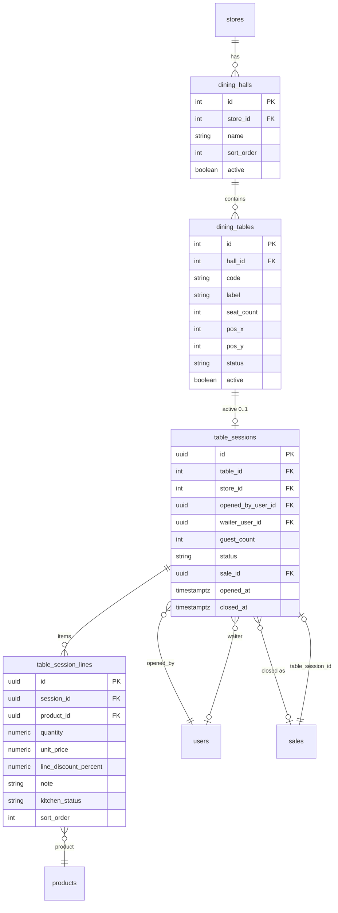

# Модуль «Ресторан / Зал и столы»

Обслуживание в зале: залы, столы, официанты, открытый счёт на столе, закрытие через существующую кассу и `SaleCheckoutService`.

## Архитектурное решение

| Вопрос | Решение |
|--------|---------|
| Микросервис сразу? | **Нет** — модуль в `web-backend` (`com.pos.restaurant`) |
| Отдельный экран кассы? | **Да** — `/cashier/restaurant` |
| CANTEEN | Обычная касса `/cashier/pos` |
| RESTAURANT | Ресторанная касса + админка зала |
| Оплата / смена / Z-отчёт | Переиспользуем существующий POS |
| Каталог блюд | `GET /products` + `business-config` (attributes) |
| MS позже (R3) | Только KDS + realtime, если понадобится |

```
┌─────────────────────────────────────────────────────────────────┐
│ web-frontend                                                     │
│  /cashier/pos          — розница, столовая (CANTEEN)            │
│  /cashier/restaurant   — план зала, стол, корзина стола           │
│  /restaurant/floor     — админ: залы и столы (ADMIN/MANAGER)      │
└───────────────────────────────┬─────────────────────────────────┘
                                │ JWT /api/v1
┌───────────────────────────────▼─────────────────────────────────┐
│ web-backend (pos_db)                                               │
│  com.pos.restaurant.*  — halls, tables, sessions, session_lines  │
│  com.pos.sale.*        — SaleCheckoutService (без изменений ядра)  │
│  sales.table_session_id — связь чека со столом                     │
└─────────────────────────────────────────────────────────────────┘
```

---

## Доменная модель (ER)



### Статусы

**`dining_tables.status`** (денормализован для UI плана зала):
- `FREE` — свободен
- `OCCUPIED` — есть открытая сессия
- `RESERVED` — Phase R2

**`table_sessions.status`**:
- `OPEN` — стол открыт, можно добавлять позиции
- `BILLING` — запрошен счёт, позиции frozen (опционально MVP)
- `CLOSED` — оплачен, есть `sale_id`
- `CANCELLED` — отмена без оплаты (только MANAGER)

**`table_session_lines.kitchen_status`** (Phase R2, колонка сразу nullable):
- `null` / `PENDING` / `IN_PROGRESS` / `READY` / `SERVED`

---

## Liquibase v12 — схема

Файл: `web-backend/src/main/resources/db/changelog/v12-restaurant-floor.xml`

### Таблицы

```sql
-- dining_halls
id, store_id, name, sort_order, active, created_at, updated_at
UNIQUE (store_id, name)

-- dining_tables
id, hall_id, code, label, seat_count, pos_x, pos_y, width, height,
status, active, created_at, updated_at
UNIQUE (hall_id, code)

-- table_sessions
id UUID, table_id, store_id, company_id,
opened_by_user_id, waiter_user_id,
guest_count, status, sale_id NULL,
notes, opened_at, closed_at, updated_at
INDEX (store_id, status), INDEX (table_id) WHERE status = 'OPEN'

-- table_session_lines
id UUID, session_id, product_id,
quantity, unit_price, line_discount_percent, note,
kitchen_status, sort_order, created_at
```

### Расширение sales

```sql
ALTER TABLE sales ADD COLUMN table_session_id UUID REFERENCES table_sessions(id);
ALTER TABLE sales ADD COLUMN service_mode VARCHAR(20) NOT NULL DEFAULT 'RETAIL';
-- service_mode: RETAIL | TABLE | DELIVERY
```

### Роль WAITER

```sql
INSERT INTO roles (name, description)
VALUES ('WAITER', 'Restaurant floor service')
ON CONFLICT DO NOTHING;
```

### Правило business_type (RESTAURANT)

```sql
INSERT INTO business_type_rules (business_type_id, rule_key, rule_value)
SELECT bt.id, 'pos.mode', 'TABLE'
FROM business_types bt WHERE bt.code = 'RESTAURANT'
ON CONFLICT DO NOTHING;
```

### Phase R0 в том же или отдельном v12-r0: restaurant product fields

```sql
-- RESTAURANT + CANTEEN fields in business_type_fields:
-- preparation_time_min (NUMBER)
-- kitchen_department (LIST → reference_book kitchen_departments)
-- combo_component (BOOLEAN)
-- migrate restaurant_product_details → product_attributes
-- drop restaurant_product_details
```

---

## Backend — структура пакетов

```
web-backend/src/main/java/com/pos/restaurant/
├── controller/
│   ├── DiningHallController.java          # admin CRUD
│   ├── DiningTableController.java         # admin CRUD + layout
│   ├── TableSessionController.java        # floor operations
│   └── RestaurantFloorQueryController.java # snapshot плана зала
├── dto/
├── entity/
│   ├── DiningHall.java
│   ├── DiningTable.java
│   ├── TableSession.java
│   ├── TableSessionLine.java
│   └── TableSessionStatus.java
├── mapper/
├── repository/
├── service/
│   ├── interface/
│   │   ├── DiningHallService.java
│   │   ├── DiningTableService.java
│   │   ├── TableSessionService.java
│   │   └── TableSessionCheckoutService.java
│   └── impl/
└── support/
    ├── TableSessionLinePricingSupport.java
    └── RestaurantFloorSnapshotSupport.java
```

### Ключевые сервисы

**`TableSessionService`**
- `openSession(tableId, guestCount, waiterUserId?)` — одна OPEN-сессия на стол
- `addLine(sessionId, productId, qty, note?)` — цена из `product_store_prices` / catalog
- `updateLine / removeLine`
- `assignWaiter(sessionId, waiterUserId)`
- `cancelSession(sessionId)` — MANAGER only

**`TableSessionCheckoutService`**
- `buildCheckoutPreview(sessionId)` → subtotal, lines (для UI оплаты)
- `closeAndPay(sessionId, CreateSaleRequest paymentPart)`:
  1. Загрузить OPEN session + lines
  2. Смапить lines → `List<SaleItemRequest>`
  3. `saleCheckoutService.processSale(req, cashierId)`
  4. `session.status = CLOSED`, `session.saleId = sale.id`
  5. `table.status = FREE`
  6. В `sales`: `table_session_id`, `service_mode = TABLE`

Списание остатков — **только при checkout** (как розница), не при добавлении в стол.

---

## API

Базовый префикс: `/api/v1/restaurant`

Swagger: `@Operation` + `@ApiResponse` на всех методах.

### Админка зала — `ADMIN`, `MANAGER`

| Method | Path | Описание |
|--------|------|----------|
| GET | `/stores/{storeId}/halls` | Список залов |
| POST | `/stores/{storeId}/halls` | Создать зал |
| PUT | `/halls/{id}` | Обновить зал |
| DELETE | `/halls/{id}` | Деактивировать |
| GET | `/halls/{hallId}/tables` | Столы зала |
| POST | `/halls/{hallId}/tables` | Создать стол |
| PUT | `/tables/{id}` | Обновить (код, места, layout) |
| PUT | `/halls/{hallId}/tables/layout` | Batch update pos_x/y |
| DELETE | `/tables/{id}` | Деактивировать |

### Операции зала — `WAITER`, `CASHIER`, `MANAGER`

| Method | Path | Описание |
|--------|------|----------|
| GET | `/stores/{storeId}/floor` | Snapshot: залы + столы + active sessions |
| POST | `/tables/{tableId}/sessions` | Открыть стол `{ guestCount, waiterUserId? }` |
| GET | `/sessions/{sessionId}` | Детали сессии + lines |
| POST | `/sessions/{sessionId}/lines` | Добавить позицию |
| PUT | `/sessions/{sessionId}/lines/{lineId}` | Изменить qty/note |
| DELETE | `/sessions/{sessionId}/lines/{lineId}` | Удалить позицию |
| PATCH | `/sessions/{sessionId}/waiter` | Назначить официанта |
| POST | `/sessions/{sessionId}/checkout-preview` | Итоги перед оплатой |
| POST | `/sessions/{sessionId}/checkout` | Оплата → sale |
| POST | `/sessions/{sessionId}/cancel` | Отмена (MANAGER) |

### DTO примеры

```json
// GET /stores/1/floor
{
  "halls": [{
    "id": 1,
    "name": "Основной зал",
    "tables": [{
      "id": 12,
      "code": "T12",
      "label": "Стол 12",
      "seatCount": 4,
      "posX": 120,
      "posY": 80,
      "status": "OCCUPIED",
      "activeSession": {
        "id": "uuid",
        "guestCount": 3,
        "waiterName": "Иван",
        "openedAt": "2026-06-09T19:30:00Z",
        "linesCount": 5,
        "subtotal": 185000
      }
    }]
  }]
}
```

```json
// POST /sessions/{id}/checkout
{
  "paymentMethod": "CASH",
  "cashAmount": 185000,
  "amountTendered": 200000,
  "orderDiscountAmount": 0,
  "notes": "Стол 12"
}
```

---

## Frontend

### Новые маршруты

**`web-frontend/src/router/cashier.routes.jsx`**
```jsx
<Route path="restaurant" element={<RestaurantPosPage />} />
```

**`web-frontend/src/router/admin.routes.jsx`**
```jsx
<Route path="restaurant/floor" element={<RestaurantFloorPage />} />
```

### Переключение кассы по типу магазина

В `CashierRoute` или `RoleHomeRedirect`:
```js
if (store.businessType === 'RESTAURANT') {
  return <Navigate to="/cashier/restaurant" replace />;
}
// CANTEEN, GROCERY, … → /cashier/pos
```

### Структура фич

```
web-frontend/src/features/
├── restaurant-cashier/
│   ├── pages/RestaurantPosPage.jsx
│   ├── components/
│   │   ├── RestaurantFloorPlan.jsx      # SVG/canvas столы
│   │   ├── RestaurantTableCard.jsx
│   │   ├── RestaurantSessionPanel.jsx   # корзина стола
│   │   └── RestaurantOpenTableModal.jsx # гости + официант
│   ├── hooks/
│   │   ├── useRestaurantFloor.js
│   │   ├── useTableSession.js
│   │   └── useRestaurantCheckout.js
│   └── styles/restaurant-cashier.css
└── restaurant-floor/
    ├── pages/RestaurantFloorPage.jsx    # админка
    ├── components/HallEditor.jsx
    └── components/TableLayoutEditor.jsx
```

### Переиспользование из cashier

| Компонент | Использование |
|-----------|---------------|
| `PosCatalogPanel` / `usePosProductsCatalog` | Выбор блюд |
| `PosPaymentFlow` | Оплата при закрытии стола |
| `useCashierShift` | Смена обязательна |
| `CashierLayout` | Оболочка кассы |
| `WeightEntryModal` | Весовые блюда (если WEIGHT) |

### Экраны (wireframe логика)

**1. План зала** (`RestaurantPosPage`, pane=floor)
- Сетка/SVG: столы цветом по статусу
- Тап FREE → модалка «Гости / официант» → open session
- Тап OCCUPIED → pane=session

**2. Сессия стола** (pane=session)
- Слева: каталог (reuse)
- Справа: позиции стола, итог, кнопки «На кухню» (R2 stub), «Оплатить»
- «Оплатить» → `PosPaymentFlow` → `POST checkout`

**3. Админка** (`/restaurant/floor`)
- CRUD залов
- Редактор расположения столов (drag на сетке)
- Список столов таблицей (fallback без canvas)

### Module handbook

```js
// moduleHandbook.js
{ id: 'restaurantPos', group: 'cashier', roles: ['CASHIER', 'WAITER', 'MANAGER'] },
{ id: 'restaurantFloor', group: 'settings', roles: ['ADMIN', 'MANAGER'] },
```

---

## Безопасность и tenant

- Все запросы через `TenantAccessSupport.assertCanAccessStore(store)`
- `WAITER` видит только столы своего `store` (из `user_stores`)
- Опционально: WAITER видит только свои сессии (`waiter_user_id = currentUser`) — флаг в `business_type_rules`: `restaurant.waiterOwnTablesOnly`

---

## Интеграция с отчётами

MVP: фильтр в sales ledger по `service_mode = TABLE`.

Phase R2: отчёт «Выручка по официантам» (`waiter_user_id` на session).

---

## Спринт-план (R0 + R1)

### Спринт 1 — R0 подготовка (3–4 дня)

| # | Задача | Слой |
|---|--------|------|
| 1 | Liquibase: restaurant fields + migrate `restaurant_product_details` | DB |
| 2 | Удалить `restaurantDetails` из API (как construction) | Backend |
| 3 | Seed `kitchen_departments` reference book + platform UI | Platform |
| 4 | Правило `pos.mode=TABLE` для RESTAURANT | DB + config |

### Спринт 2 — схема и админка (4–5 дней)

| # | Задача | Слой |
|---|--------|------|
| 5 | Liquibase v12: halls, tables, sessions, lines, sales columns | DB |
| 6 | Entity, repository, service, mapper | Backend |
| 7 | `DiningHallController`, `DiningTableController` | Backend |
| 8 | `RestaurantFloorPage` + API client | Frontend |
| 9 | Роль WAITER + module access | Backend + FE |

### Спринт 3 — касса ресторана (5–7 дней)

| # | Задача | Слой |
|---|--------|------|
| 10 | `RestaurantFloorQueryController` + `TableSessionService` | Backend |
| 11 | open / add line / remove line API | Backend |
| 12 | `RestaurantPosPage` + floor plan UI | Frontend |
| 13 | `RestaurantSessionPanel` + catalog reuse | Frontend |
| 14 | Редирект RESTAURANT → `/cashier/restaurant` | Frontend |

### Спринт 4 — оплата и polish (3–4 дня)

| # | Задача | Слой |
|---|--------|------|
| 15 | `TableSessionCheckoutService` → `SaleCheckoutService` | Backend |
| 16 | Checkout preview + payment UI | Frontend |
| 17 | Cancel session, assign waiter | Both |
| 18 | i18n ru/uz, empty states, loading | Frontend |
| 19 | Smoke: открыть стол → блюда → оплата → Z-отчёт | QA |

**Итого R1:** ~3–4 недели.

---

## Phase R2 — кухня (кратко)

- `kitchen_tickets` при `POST lines` или отдельная кнопка «На кухню»
- `/kitchen` — список по `kitchen_department`
- WebSocket `STOMP /topic/kitchen/{storeId}` или polling 5s

---

## Phase R3 — микросервис (когда выносить)

Критерии:
- KDS на отдельных планшетах с высокой нагрузкой
- Нужен деплой kitchen без backend POS

Выносим: `dining_*`, `table_sessions*`, `kitchen_tickets`, realtime.  
Оставляем в monolith: `sales`, оплата, склад, смены.

Паттерн: `restaurant-service` + `RestaurantGatewayController` в web-backend (как finance).

---

## Чеклист перед стартом разработки

- [ ] Утвердить MVP: без брони, без split bill, без чаевых
- [ ] Один официант на стол (несколько — R2)
- [ ] Списание остатков при checkout (не при add line)
- [ ] CANTEEN остаётся на `/cashier/pos`

---

## Порядок первого PR

Рекомендуемый первый PR (маленький, reviewable):

1. `v12-r0-restaurant-product-fields.xml` — attributes, drop legacy table
2. Backend cleanup `restaurantDetails`
3. Без UI зала — только подготовка каталога

Второй PR: схема зала + admin API + admin UI.  
Третий PR: restaurant cashier.
